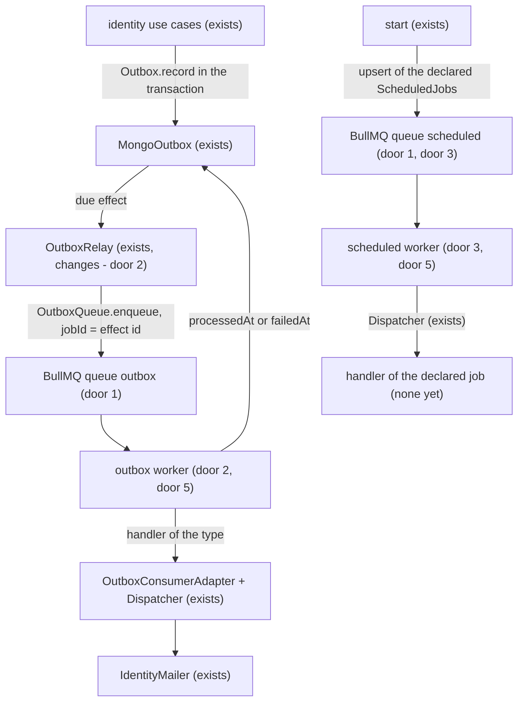

# BullMQ jobs

## Problem

All background work runs in a loop inside the API process: the `OutboxRelay` reads the pending
effect from Mongo every 1 s, runs its handler right there, one at a time, and does its own retry
with backoff (ADR-010). There is no way to run something at a time of day: no module can declare
"every day at 9 am", and such a task today would be born as a `setInterval` in every API instance,
repeating the work in all of them.

There is no production evidence (the project has no real traffic yet). The item comes from
`NEXT-STEPS.md`, section 5 ("BullMQ, sobre o Redis que já está no compose"), and `STACK.md` already
lists BullMQ as _planned_ for background and scheduled jobs.

When this ships: the outbox effects are run by a BullMQ worker, with its attempts and backoff, and
Mongo stays the transactional record of each effect; and a module declares scheduled jobs the way it
declares routes, each running once per occurrence. No module declares one yet.

## Flow

Reuses the `Outbox`/`MongoOutbox` and the relay's reservation (ADR-010) as they are, the
`OutboxConsumer`s and the `OutboxConsumerAdapter` to run each effect, the `Dispatcher` for the
scheduled jobs and the `REDIS_URL` that already exists.

- The relay stops running the handler: it reserves the effect as today, hands it to the queue and
  extends the reservation; the worker is what runs it, retries it and records the end in Mongo.
- A scheduled job's handler is a presentation `Handler`, like a route's; one that has to send an
  e-mail records an effect in the outbox and goes through the same path as any effect.

## Impact

| Front       | What changes                                                                                                                                                                                                                                                                                       |
| ----------- | -------------------------------------------------------------------------------------------------------------------------------------------------------------------------------------------------------------------------------------------------------------------------------------------------- |
| domain      | new term: `OutboxQueue` - port through which the relay hands an effect over to be run (`src/shared/application/ports`); the BullMQ adapter lives in `src/shared/infrastructure`                                                                                                                    |
| domain      | new term: `ScheduledJob` - work that runs at a time (cron + time zone), declared by a module like a route (`Entry` + `name` + `schedule`); lives in `src/shared/presentation`; `IdentityModule` starts exposing `scheduledJobs`, empty for now                                                     |
| domain      | existing term: `OutboxRelay` ran the effect and decided the retry; now it only hands it to the queue and extends the reservation. Who depends on it: `start` and the relay spec. `OutboxStore.scheduleRetry` loses its use and leaves the port (implemented by `MongoOutbox` and `InMemoryOutbox`) |
| behaviour   | the effects' retry policy moves to BullMQ: up to 8 attempts, exponential backoff from 30 s with full jitter and without the 30 min cap (the last wait goes up to 32 min); `shared.outbox_effect_failed` and `shared.outbox_effect_abandoned` stay, emitted by the worker                           |
| behaviour   | up to 5 effects run at the same time (today, one at a time)                                                                                                                                                                                                                                        |
| behaviour   | `start` opens BullMQ connections to Redis for the two workers (the queues reuse the `RedisConnection` client, door 6) and starts them after `listen`; `stop` closes workers and queues before Redis and Mongo, each worker waiting only for the jobs it is running, even with Redis away           |
| security    | while the effect is in the queue, the plain-text token is also in Redis (job data) and in an RDB/AOF snapshot if Redis persists; the job is deleted when it ends (door 2)                                                                                                                          |
| ops         | Redis needs `maxmemory-policy noeviction` (BullMQ warns in the log when it is not); compose's `redis:8` already uses that default, but a managed Redis in production has to be set that way                                                                                                        |
| stored data | `outbox`: nothing to migrate; an effect pending from before the deploy enters the queue                                                                                                                                                                                                            |
| tests       | the relay spec starts checking the hand-off to the queue with a fake `OutboxQueue`; identity's specs that read e-mails from the outbox (`recordedEmails`) stay the same                                                                                                                            |
| docs        | new ADR (BullMQ runs the outbox and the scheduled jobs; replaces the running and retry of ADR-010 doors 3 and 4); `STACK.md` "Messaging and jobs" and the CI line in "Delivery", left _planned_; `NEXT-STEPS.md` section 5; readme                                                                 |

## Relations

None - no stored-data shape change: the `OutboxEffect` keeps ADR-010's shape, and `lockedUntil` also
becomes the deadline of the hand-off to the queue (door 2).

## Surface

None - nothing consumed outside; no new route and no changed signature.

## Landing

| One-way door                                                                            | Literal shape                                                                                                                                                                                                                                                                                                                                                                                                                                                                                                                                                                                                                                                                      | Alternative rejected                                                                                                                                                                                                                                                                                                                                                                                                                                                                                                  |
| --------------------------------------------------------------------------------------- | ---------------------------------------------------------------------------------------------------------------------------------------------------------------------------------------------------------------------------------------------------------------------------------------------------------------------------------------------------------------------------------------------------------------------------------------------------------------------------------------------------------------------------------------------------------------------------------------------------------------------------------------------------------------------------------- | --------------------------------------------------------------------------------------------------------------------------------------------------------------------------------------------------------------------------------------------------------------------------------------------------------------------------------------------------------------------------------------------------------------------------------------------------------------------------------------------------------------------- |
| 1. Dependency and shape in Redis                                                        | `bullmq@6.3.17` (peer `ioredis`, already installed); queues `outbox` and `scheduled` with `prefix` = `APP_NAME` (keys `<APP_NAME>:outbox:*`); BullMQ's own connections created with `{ url: REDIS_URL }`, apart from the `RedisConnection`                                                                                                                                                                                                                                                                                                                                                                                                                                         | reusing the `RedisConnection` client: BullMQ's Worker refuses a client with `maxRetriesPerRequest` set, and clearing that value would make the cache and the rate limit wait for Redis to come back instead of failing fast; Agenda (a scheduler on Mongo): one more dependency and polling Mongo for something Redis already does; `node-cron` in the process: every API instance would fire the same task                                                                                                           |
| 2. Relay hands over to BullMQ (replaces ADR-010's running)                              | the relay reserves as today (`lockedUntil` = now + 30 s), calls `OutboxQueue.enqueue(effect)` → `queue.add(effect.type, { payload }, { jobId: effect.id, attempts: 8, backoff: { type: "exponential", delay: 30_000, jitter: 1 }, removeOnComplete: true, removeOnFail: true })` and writes `lockedUntil` = now + 2 h; the worker (concurrency 5) runs the handler of the type and then writes `processedAt`; the 8th failure, a refused payload (`shared.input_invalid`, rethrown as `UnrecoverableError`) or a type with no handler write `failedAt`; with the 2 h past and the effect still pending, the relay hands it over again and the `jobId` keeps a single job           | marking the effect processed when handing it to the queue: a lost Redis would take the e-mail with it, with no trace in Mongo; keeping the retry in the relay and using BullMQ only for scheduled jobs: option discarded in this conversation                                                                                                                                                                                                                                                                         |
| 3. Scheduled jobs declared by the module (precedent)                                    | `export type ScheduledJob = Entry & Readonly<{ name: string; schedule: Readonly<{ pattern: string; tz: string }> }>` (`src/shared/presentation/scheduling`); each module lists its own in its `scheduledJobs` (`IdentityModule.scheduledJobs`, empty today); on `start`, `queue.upsertJobScheduler(job.name, { pattern, tz }, { name: job.name, opts: { attempts: 3, backoff: { type: "exponential", delay: 60_000 }, removeOnComplete: true, removeOnFail: 100 } })` for each and `removeJobScheduler(id)` for every scheduler of the queue no module declares; the worker dispatches through the `Dispatcher` as `Inbound { input: {}, metadata: {}, ip: "", actor: undefined }` | the module calling BullMQ directly: the vendor would leak into the modules, which today know neither Express nor Mongoose outside the infrastructure; scheduling by interval only (`every`): cannot say "at 9 am"                                                                                                                                                                                                                                                                                                     |
| 4. `OutboxQueue` port (precedent)                                                       | `export type OutboxQueue = { enqueue(effect: OutboxEffect): Promise<void> }` in `src/shared/application/ports/outbox-queue.ts`; `OutboxStore.scheduleRetry` leaves the port                                                                                                                                                                                                                                                                                                                                                                                                                                                                                                        | the relay importing BullMQ: the application layer imports no library (ESLint rule)                                                                                                                                                                                                                                                                                                                                                                                                                                    |
| 5. Workers in the API process                                                           | `start` creates queues and workers after `listen`; `stop` stops the relay, closes the workers (waiting for the jobs in progress) and the queues, and only then closes Redis and Mongo                                                                                                                                                                                                                                                                                                                                                                                                                                                                                              | a separate worker process: another entry point, another image or compose service, with no volume to justify it; it can be split later because queues and workers are classes created in `start`                                                                                                                                                                                                                                                                                                                       |
| 6. Queues on the shared client, workers on their own connections (found while building) | the `outbox` and `scheduled` queues take the `RedisConnection` client (`connection: redis.client`: `enableOfflineQueue: false`, `commandTimeout` 500 ms, closed by `RedisConnection.close`); only the workers open their own connections (`{ url: REDIS_URL }`, blocking); a worker closes by waiting for the jobs it is running and then calling `close(true)`                                                                                                                                                                                                                                                                                                                    | BullMQ's own connection for the queues (door 1 as approved): measured against a Redis that went away, an enqueue waited without failing, so the relay never logged it and `stop` hung on it, and the queue's `close()` and `disconnect()` both hung; the worker's graceful `close()`: hung for as long as Redis stayed away, so Mongo and Sentry were never closed; graceful `close()` with a deadline and then `close(true)`: BullMQ 6.3.17 returns the pending close to the second call, so the force never happens |

- Nothing else in this change is hard to reverse

## Criteria

### S1: The BullMQ worker runs the outbox effects (P1)

The reset and verification e-mails go out through BullMQ, with its retry, and Mongo still knows how
each effect ended.

**Acceptance Criteria**

1. WHEN the relay finds a due effect THEN the system SHALL add to the `outbox` queue a job named after the effect's `type`, with `jobId` equal to the effect id and the `payload` in its data, and SHALL write `lockedUntil` = now + 2 h on the effect
2. WHEN the handler of the type finishes without error THEN the system SHALL write `processedAt`, erase the `payload` and write `expiresAt` = `processedAt` + 7 days
3. IF the handler fails THEN the system SHALL run the job again until 8 attempts are complete, waiting 30 s × 2^(attempt − 1) with full jitter between them, and SHALL log `warn` `shared.outbox_effect_failed` with `id`, `type` and `attempts` on each failure
4. IF the 8th attempt fails THEN the system SHALL write `failedAt`, `attempts` = 8 and `lastError`, erase the `payload`, write `expiresAt` = `failedAt` + 7 days and log `error` `shared.outbox_effect_abandoned` with `id`, `type` and `attempts`
5. IF the handler refuses the payload with `shared.input_invalid`, or the type has no handler, THEN the system SHALL abandon the effect on that same attempt, with no new attempt, writing and logging as in criterion 4
6. IF the 2 h of a handed-over effect pass and it still has no `processedAt` and no `failedAt` THEN the relay SHALL hand it over again, and the queue SHALL keep a single job of that `jobId` while the first one exists
7. IF adding the job fails (Redis down) THEN the relay SHALL log `error` `shared.outbox_relay_failed`, leave the effect pending and hand it over again after the 30 s reservation passes
8. WHEN a job of the `outbox` queue ends, succeeded or abandoned, THEN the system SHALL remove it from Redis
9. WHEN the app stops THEN the system SHALL stop the relay, wait for the jobs in progress and close workers and queues before closing Redis and Mongo

**Independent test:** with a mailer that fails once and then works, a requested reset leaves the
effect with `processedAt` after the second attempt, and the `outbox` queue ends empty.

### S2: A module declares a scheduled job (P2)

A task with a time of day runs once per occurrence, however many API instances there are.

**Acceptance Criteria**

10. WHEN the app starts THEN the system SHALL create or update in the `scheduled` queue one scheduler per declared `ScheduledJob`, with id equal to the `name` and the declared `pattern` and `tz`
11. WHEN the app starts and the `scheduled` queue has a scheduler no module declares THEN the system SHALL remove it
12. WHEN a scheduler fires THEN the system SHALL dispatch the job to the declared handler through the `Dispatcher` once per occurrence, even with two workers on the same Redis
13. IF the handler of a scheduled job fails THEN the system SHALL run it again up to 3 attempts, with exponential backoff from 60 s, and SHALL log `warn` `shared.scheduled_job_failed` with `name`, `attempts` and the error on each failure

**Independent test:** a test `ScheduledJob` with a pattern that fires every second calls the
handler once per occurrence with two workers on the same in-memory Redis.

## Out of scope

| Excluded                                   | Why                                                                                                                               |
| ------------------------------------------ | --------------------------------------------------------------------------------------------------------------------------------- |
| an effect delayed by the use case's choice | no effect needs it today; `nextAttemptAt` already allows recording an effect for later, and the relay only hands it over when due |
| a queue dashboard (Bull Board or similar)  | it is an exposed surface that needs its own authentication; it comes when someone needs to operate the queue                      |
| reprocessing abandoned effects             | already out in ADR-010; the abandonment stays visible only in the log                                                             |
| the e-mail verification reminder           | planned as the first scheduled job and removed by the user after the build; the setup stays with no job declared                  |
| queue metrics (OpenTelemetry)              | OpenTelemetry is its own item in `NEXT-STEPS.md`                                                                                  |

## Assumptions

| Assumption                | Chosen default          | Rationale                                                                                            | Confirmed? |
| ------------------------- | ----------------------- | ---------------------------------------------------------------------------------------------------- | ---------- |
| outbox worker concurrency | 5 jobs at the same time | user delegated - the current relay delivers one at a time; 5 uses BullMQ without pressing MailerSend | y          |
| deadline of the hand-off  | 2 h                     | user delegated - longer than the sum of the 8 waits (up to about 63 min) plus the run                | y          |

**Open questions:** none - all resolved or logged above.

## Observable

None - no user-facing surface: no route changes, and the queues are reached only by the API process
through Redis on the internal network.

## Sources

- `NEXT-STEPS.md`, section 5 - BullMQ: repeatable jobs instead of cron and the relay enqueuing on BullMQ
- `docs/adr/010-transactional-outbox-in-mongo-with-an-in-process-relay.md` - outbox in Mongo, swappable transport later
- the user's decision in this conversation - every effect through BullMQ and the scheduled-job capability; later, the verification reminder removed
