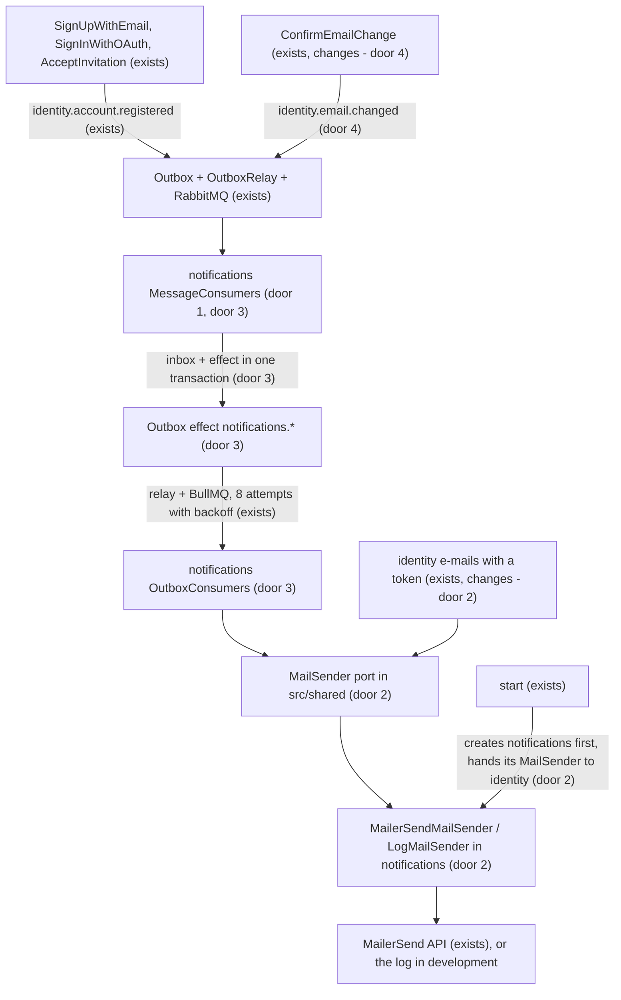

# Notifications e-mails

## Problem

Only identity knows how to send an e-mail: the MailerSend adapter and the log mailer live inside it
(`MailerSendIdentityMailer`, `LogIdentityMailer`). Any other module that needs to tell someone
something by e-mail would have to ask identity or copy the adapter.

The "your e-mail was changed" notice, sent to the old address when the change is confirmed, leaves
after the commit, straight from the request and with no new attempt: if MailerSend fails at that
moment, identity only logs `identity.email_changed_notice_not_sent` and the account owner never
learns of it. It is a security notice - whoever gets it is precisely the person who may have lost
the account.

Whoever creates an account gets no welcome message. Identity already publishes
`identity.account.registered` (feature `rabbitmq-events`), but nobody listens.

There are no production figures. The request comes from the user, in this conversation: e-mails 5
(e-mail changed notice) and 6 (welcome) become the `notifications` module's; "the adapter has to
live in notifications, whoever needs it uses a port".

When this ships: every account created (sign-up, first OAuth sign-in, accepted invitation) gets a
welcome e-mail; the e-mail changed notice leaves from `notifications`, with BullMQ's 8 attempts and
backoff; identity's e-mails with a token stay the same for whoever gets them, but go out through
the adapter that now lives in `notifications`.

## Flow

Reuses the outbox, the relay and RabbitMQ (ADR-010, ADR-012, ADR-013) for the events and the
effects, the inbox so an event does not repeat, and the texts and layout identity already composes.

- `notifications` does not call MailerSend inside the subscriber: the subscriber only records an
  effect in the outbox, in the inbox's transaction, and the sending goes through BullMQ.
  RabbitMQ's 5 attempts happen within milliseconds; BullMQ's wait from 30 s to 32 min.
- Identity imports nothing from `notifications`: it uses the `MailSender` port of `src/shared`, and
  `start` hands it the adapter `notifications` created.

## Impact

| Front       | What changes                                                                                                                                                                                                                                                                |
| ----------- | --------------------------------------------------------------------------------------------------------------------------------------------------------------------------------------------------------------------------------------------------------------------------- |
| domain      | new term: `notifications` module - sends the e-mails that are not identity's, in response to events; it has no routes and no data of its own                                                                                                                                |
| domain      | new term: `MailSender` - port that sends an already composed e-mail (`src/shared/application/ports`); the adapter lives in `notifications`                                                                                                                                  |
| domain      | existing term: `IdentityMailer` loses `sendEmailChanged` and `EmailChangedNotice`; the only caller today is `ConfirmEmailChange`                                                                                                                                            |
| domain      | existing term: `ConfirmEmailChange` publishes `identity.email.changed` in the transaction instead of sending the notice after it; the `identity.email_changed_notice_not_sent` log goes away                                                                                |
| behaviour   | the password reset, verification, invitation and e-mail change e-mails keep subject, text and link; the invitation and the change still answer `identity.email_delivery_failed` when sending fails                                                                          |
| behaviour   | every account created starts getting the welcome e-mail, after the verification one or before it - no order between the two                                                                                                                                                 |
| ops         | the sending logs change names: `identity.email_logged` becomes `notifications.email_logged` (where the link shows up in development) and `identity.email_delivery_failed` becomes `notifications.email_delivery_failed`; whoever filters by the old names stops seeing them |
| config      | the `MAILER`, `MAIL_FROM_EMAIL`, `MAIL_FROM_NAME` and `MAILERSEND_API_KEY` variables do not change; they move from identity's settings to `notifications`'                                                                                                                  |
| tests       | identity's mailer specs move to `notifications`; the `start` e2e that counts `identity.email_logged` counts `notifications.email_logged`                                                                                                                                    |
| stored data | `outbox`: new effect types `notifications.welcome_email` and `notifications.email_changed_notice`; `inbox`: entries of the two new subscribers; nothing to migrate                                                                                                          |
| docs        | new ADR (`notifications` module and the `MailSender` port); `STACK.md`; readme (the link in development shows up in `notifications.email_logged`)                                                                                                                           |

## Relations

None - no stored-data shape changes; the new effects and entries use the `outbox` and `inbox`
collections as they are.

## Surface

None - no new route and no changed signature; the contract of the `identity.email.changed` event is
in door 4.

## Landing

| One-way door                                                      | Literal shape                                                                                                                                                                                                                                                                                                                                                                                                                                                                                                                                                                              | Alternative rejected                                                                                                                                                                                                     |
| ----------------------------------------------------------------- | ------------------------------------------------------------------------------------------------------------------------------------------------------------------------------------------------------------------------------------------------------------------------------------------------------------------------------------------------------------------------------------------------------------------------------------------------------------------------------------------------------------------------------------------------------------------------------------------ | ------------------------------------------------------------------------------------------------------------------------------------------------------------------------------------------------------------------------ |
| 1. `notifications` module (precedent: a module with no routes)    | `src/modules/notifications/` with the usual layers; `createNotificationsModule(settings: NotificationsSettings, runtime: NotificationsRuntime)` returns `{ mailSender, messageConsumers, outboxConsumers }`; `NotificationsSettings = { appUrl, productName, mailer: { kind, apiKey, from } }`; `public.ts` with no exports for now; `start` joins both modules' consumers                                                                                                                                                                                                                 | the welcome in identity: it would come to know every notice someone wants to send, the opposite of "emit events and whoever wants listens"                                                                               |
| 2. `MailSender` port in shared, adapter in `notifications`        | `src/shared/application/ports/mail-sender.ts`: `OutgoingEmail = { template: string; to: string; name: string; subject: string; text: string; link: string \| null; expiresAt: Date \| null }` and `MailSender = { send(email: OutgoingEmail): Promise<void> }` - rejects when the e-mail does not go out; adapters `MailerSendMailSender` and `LogMailSender` in `src/modules/notifications/infrastructure`; `start` creates one per process and hands it to identity in `IdentityRuntime.mail`; identity composes the texts and turns the rejection into `identity.email_delivery_failed` | the adapter in shared: the user wants the adapter in `notifications`; the port in `notifications`' `public.ts`: identity would come to depend on `notifications`; one adapter per module: two MailerSend implementations |
| 3. The subscriber records an effect, the effect sends (precedent) | subscribers `notifications.schedule_welcome_email` (of `identity.account.registered`) and `notifications.schedule_email_changed_notice` (of `identity.email.changed`) record, in the inbox's transaction, the effects `notifications.welcome_email` `{ to, name }` and `notifications.email_changed_notice` `{ to, name, newEmail }`; outbox consumers `notifications.send_welcome_email` and `notifications.send_email_changed_notice` send through the `MailSender`                                                                                                                      | sending the e-mail inside the subscriber: 5 attempts in a row, within milliseconds, then the dead-letter queue; a MailerSend failure of a few minutes would lose the e-mail                                              |
| 4. `identity.email.changed` event                                 | payload `{ accountId: string, previousEmail: string, newEmail: string, name: string }`, published by `ConfirmEmailChange` in the change's transaction; the name and the payload type go out through identity's `public.ts`                                                                                                                                                                                                                                                                                                                                                                 | keeping the notice in identity: no new attempt, which is the problem; only the `accountId`: `notifications` would have to ask identity for the old e-mail, which the account no longer has                               |
| 5. Sending logs in `notifications`                                | `notifications.email_logged` `{ template, to, link, expiresAt }` (info) and `notifications.email_delivery_failed` `{ template, failure, status? }` (error); `identity.email_logged`, `identity.email_delivery_failed` and `identity.email_changed_notice_not_sent` go away                                                                                                                                                                                                                                                                                                                 | keeping the `identity.*` names: the sender is `notifications`' adapter, and a log named after a module that did not write it misleads whoever investigates                                                               |

- Nothing else in this change is hard to reverse

## Criteria

### S1: A welcome for every account created (P1)

Whoever creates an account gets a welcome e-mail, only once.

**Acceptance Criteria**

1. WHEN `notifications` receives `identity.account.registered` THEN the system SHALL record in the outbox, in the same transaction as the inbox entry, the effect `notifications.welcome_email` with `to` = the event's `email` and `name` = the event's `name`
2. The system SHALL record the effect for the three `registeredVia` (`sign_up`, `oauth`, `invitation`)
3. IF the same event reaches the subscriber twice THEN the system SHALL NOT record a second effect
4. WHEN the `notifications.welcome_email` effect runs THEN the system SHALL send through the `MailSender` an e-mail with `template` = `welcome`, the effect's `to` and `name`, subject `Boas-vindas ao <product>` and a text with the name and the `APP_URL` link
5. IF the `MailSender` rejects the sending THEN the system SHALL leave the effect to BullMQ's next attempt, without marking it processed

**Independent test:** with the API running and `MAILER=log`, an e-mail sign-up makes
`notifications.email_logged` show up with `template` = `welcome` and the account's e-mail.

### S2: The e-mail changed notice leaves from `notifications` (P1)

The account owner learns of the change even if MailerSend is down at that moment.

**Acceptance Criteria**

6. WHEN an e-mail change is confirmed THEN identity SHALL publish `identity.email.changed` with `accountId`, `previousEmail`, `newEmail` and `name`, in the change's transaction
7. IF the change's transaction aborts THEN the system SHALL NOT keep the event
8. The identity module SHALL NOT send the e-mail changed notice itself
9. WHEN `notifications` receives `identity.email.changed` THEN the system SHALL record the effect `notifications.email_changed_notice` with `to` = `previousEmail`, `name` and `newEmail`, in the inbox's transaction
10. WHEN the `notifications.email_changed_notice` effect runs THEN the system SHALL send through the `MailSender` an e-mail with `template` = `email_changed`, to `to`, subject `Seu e-mail foi alterado` and today's text, with the new e-mail

**Independent test:** with the API running and `MAILER=log`, confirming an e-mail change makes
`notifications.email_logged` show up with `template` = `email_changed` and the old e-mail.

### S3: One e-mail adapter, in `notifications` (P1)

Identity and `notifications` send through the same adapter, created once.

**Acceptance Criteria**

11. The password reset, verification, invitation and e-mail change e-mails SHALL go out through the `MailSender` with today's `template`, subject, text and link
12. IF the `MailSender` rejects the invitation or the e-mail change THEN identity SHALL answer `identity.email_delivery_failed`, as today
13. WHERE `MAILER` = `log` the system SHALL log `info` `notifications.email_logged` with `template`, `to`, `link` and `expiresAt` and SHALL NOT call MailerSend
14. IF MailerSend does not answer `202` or the call fails THEN the system SHALL log `error` `notifications.email_delivery_failed` with `template` and the failure (and the `status`, when there is one) and SHALL reject the sending
15. WHEN the app starts THEN the system SHALL create a single `MailSender` and hand the same one to identity and `notifications`

**Independent test:** with `MAILER=log`, asking for a password reset makes
`notifications.email_logged` show up with `template` = `password_reset` and today's link.

## Out of scope

| Excluded                                                                                                                                                                                                              | Why                                                                                                                                                         |
| --------------------------------------------------------------------------------------------------------------------------------------------------------------------------------------------------------------------- | ----------------------------------------------------------------------------------------------------------------------------------------------------------- |
| moving the e-mails with a token (password reset, verification, invitation, e-mail change) to `notifications`                                                                                                          | the token is a secret and cannot go in an event; identity would have to give `notifications` an order and depend on it; the user chose only e-mails 5 and 6 |
| other identity events (`identity.password.changed`, `identity.sessions.revoked`, `identity.invitation.accepted`, `identity.account.deactivated` and `reactivated`, `identity.membership.changed`) and notices 7 to 11 | they come when a subscriber needs them; publishing with nobody listening is a contract with no use                                                          |
| HTML e-mail, branded layout                                                                                                                                                                                           | today's e-mails are text; the same format serves the two new ones                                                                                           |
| e-mail preferences, unsubscribe                                                                                                                                                                                       | both e-mails are transactional (account created, e-mail changed)                                                                                            |
| languages other than pt-BR                                                                                                                                                                                            | every e-mail today is in pt-BR                                                                                                                              |
| `notifications` routes                                                                                                                                                                                                | the module only reacts to events                                                                                                                            |

## Assumptions

| Assumption                 | Chosen default                                                                                                                             | Rationale                                                                                                                                                 | Confirmed? |
| -------------------------- | ------------------------------------------------------------------------------------------------------------------------------------------ | --------------------------------------------------------------------------------------------------------------------------------------------------------- | ---------- |
| `notifications` e-mails    | only 5 (e-mail changed notice) and 6 (welcome)                                                                                             | the user chose them from the list                                                                                                                         | y          |
| where the adapter lives    | in `notifications`; identity uses the port                                                                                                 | the user: "the adapter has to live in notifications, whoever needs it uses a port"                                                                        | y          |
| where the port lives       | `src/shared/application/ports/mail-sender.ts`                                                                                              | approved with the plan - identity does not come to depend on `notifications`; shared already holds the ports more than one module uses (`Cache`, `Clock`) | y          |
| welcome text               | `Olá, <name>.` / `Sua conta no <product> foi criada. Para entrar, acesse: <APP_URL>` / `Se você não criou esta conta, fale com o suporte.` | approved with the plan - same tone and format as today's e-mails                                                                                          | y          |
| welcome for invited people | yes, also for OAuth and the accepted invitation                                                                                            | approved with the plan - the three ways create an account; whoever was invited is also new to the product                                                 | y          |
| order between the e-mails  | no guarantee between the welcome and the verification one                                                                                  | approved with the plan - they leave by different paths (RabbitMQ + BullMQ and BullMQ only); forcing an order would need joining the two                   | y          |

**Open questions:** none - all resolved or logged above.

## Observable

| Surface                        | Decision                              | Landing                                                                                                                  |
| ------------------------------ | ------------------------------------- | ------------------------------------------------------------------------------------------------------------------------ |
| welcome e-mail                 | structure, tone, depth                | AC 4; text in Assumptions                                                                                                |
| welcome e-mail                 | what the reader does next             | AC 4 - the `APP_URL` link to sign in                                                                                     |
| e-mail changed notice          | structure, tone, depth                | AC 10 - today's text                                                                                                     |
| e-mail changed notice          | what the reader does next             | existing - "Se não foi você, fale com o suporte imediatamente."                                                          |
| identity e-mails with a token  | structure, tone, what the reader does | AC 11 - no change                                                                                                        |
| event `identity.email.changed` | content format                        | door 4, AC 6                                                                                                             |
| event `identity.email.changed` | who may consume                       | any module of the API, through identity's `public.ts`; nothing leaves the internal network                               |
| event `identity.email.changed` | versioning                            | n/a - first contract, implicit version 1, like `identity.account.registered`                                             |
| event `identity.email.changed` | error format and codes                | n/a - whoever refuses or fails is the subscriber, which already logs (`shared.message_refused`, `shared.message_failed`) |

## Sources

- the user's request in this conversation - e-mails 5 and 6 of the list, and "the adapter has to live in notifications, whoever needs it uses a port"
- `docs/adr/013-publish-events-between-modules-on-rabbitmq-from-the-outbox.md` - events, subscribers, inbox and the rule of never putting a secret in an event
