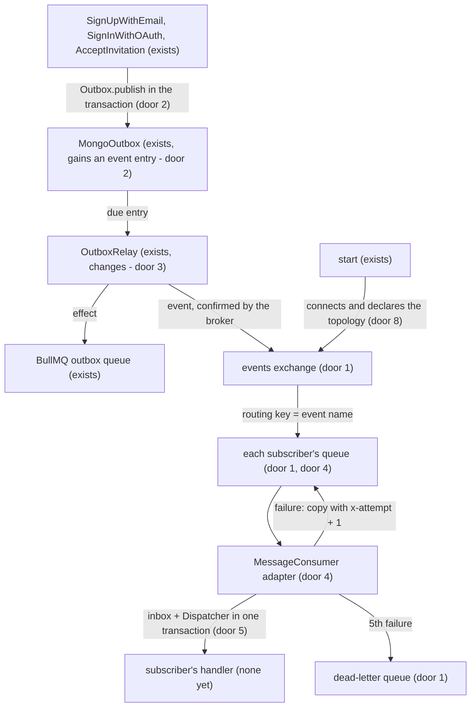

# RabbitMQ events

## Problem

Today a module has no way to announce a fact to the others. The outbox (ADR-010 and ADR-012) only
carries orders that identity itself runs, the e-mails, delivered to a single consumer by BullMQ.
When a second module needs to react to something in identity (a `notifications` sending a welcome,
an `audit` keeping the trail), the only path would be identity calling that module directly, and
identity would come to know every interested party.

There is no production evidence nor a second module yet. The item comes from `NEXT-STEPS.md`,
section 5 ("RabbitMQ + outbox"), and from `STACK.md` (RabbitMQ for events between modules,
_planned_). The user asked for the setup now, with the rule "only emit events, and whoever wants
listens".

When this ships: identity publishes `identity.account.registered` on RabbitMQ, recorded in the same
transaction as the sign-up; a module subscribes to an event by declaring a `MessageConsumer`, like
it declares a route; each subscriber gets its own copy, processes each event only once and, after
5 failed attempts, the event goes to a dead-letter queue. No module subscribes yet.

## Flow

Reuses the Mongo outbox and the relay (ADR-010, ADR-012) to publish without losing an event between
the commit and the broker, the `Dispatcher` and the `Handler` for the subscribers (ADR-001) and the
`TransactionRunner` to write the inbox together with the subscriber's writes.

- The effects (e-mails) do not change: they still go to BullMQ. Only the event entries go to
  RabbitMQ.
- The relay marks the event processed as soon as RabbitMQ confirms it got it. From then on, each
  subscriber takes care of its own copy.

## Impact

| Front       | What changes                                                                                                                                                                                                                                                                                     |
| ----------- | ------------------------------------------------------------------------------------------------------------------------------------------------------------------------------------------------------------------------------------------------------------------------------------------------ |
| domain      | new term: domain event - a fact published by a module, named `<module>.<aggregate>.<action>`, with ids and public data and never a secret; `Outbox.publish` records it with `kind: "event"`, the same method the effects use with `kind: "effect"` (door 10)                                     |
| domain      | new term: `MessageConsumer` - a module's subscription to an event (`Entry` + `event`), declared like a route; ADR-001 already foresaw it; `IdentityModule.messageConsumers` exists, empty                                                                                                        |
| domain      | existing term: `OutboxRelay` handed every entry to BullMQ; now it splits: effect to BullMQ, event to RabbitMQ                                                                                                                                                                                    |
| domain      | new term: inbox - the record of the events each subscriber already processed                                                                                                                                                                                                                     |
| domain      | existing term: `TransactionRunner.run` inside another `run` failed with `shared.nested_transaction`; now it joins the outer transaction (door 9). No code opens a `run` inside another today; the two runner specs that pinned the refusal change, and `SharedError.NestedTransaction` goes away |
| behaviour   | the e-mail sign-up, the first OAuth sign-in and the accepted invitation start publishing `identity.account.registered`; the routes' answers do not change                                                                                                                                        |
| behaviour   | the API only starts with RabbitMQ up (`RABBITMQ_URL`), as it already does with Mongo and Redis; `stop` closes the subscribers and the RabbitMQ connection before Redis and Mongo                                                                                                                 |
| ops         | new `rabbitmq` service in `docker-compose.yml` and new `RABBITMQ_URL` variable                                                                                                                                                                                                                   |
| tests       | integration and e2e start a RabbitMQ in a container (Testcontainers): Docker has to be running to run those tests and to commit, because the pre-commit runs every coverage level; CI only runs unit and does not change                                                                         |
| stored data | `outbox`: new event entries; the entries from before, without the kind, read as effects; `inbox`: new collection; nothing to migrate                                                                                                                                                             |
| docs        | new ADR (events between modules on RabbitMQ, fed by the outbox); `STACK.md` (RabbitMQ and `MessageConsumer` stop being _planned_); `NEXT-STEPS.md` section 5; readme; `.env.example`                                                                                                             |

## Relations

- Outbox entry: gains its kind, effect or event. An entry with no kind is an effect. Constraint that
  does not go back: an event never goes to BullMQ and an effect never goes to RabbitMQ (door 2).
- Inbox entry: one per subscriber and event, unique (door 5); expires 7 days later.

## Surface

None - no new route and no changed signature; the contract of the `identity.account.registered`
event is in door 6.

## Landing

| One-way door                                                       | Literal shape                                                                                                                                                                                                                                                                                                                                                                                                                                                                                                                                                                                                                                                                                                                                                                        | Alternative rejected                                                                                                                                                                                                                                                                                                                                                                                                                                                                                               |
| ------------------------------------------------------------------ | ------------------------------------------------------------------------------------------------------------------------------------------------------------------------------------------------------------------------------------------------------------------------------------------------------------------------------------------------------------------------------------------------------------------------------------------------------------------------------------------------------------------------------------------------------------------------------------------------------------------------------------------------------------------------------------------------------------------------------------------------------------------------------------ | ------------------------------------------------------------------------------------------------------------------------------------------------------------------------------------------------------------------------------------------------------------------------------------------------------------------------------------------------------------------------------------------------------------------------------------------------------------------------------------------------------------------ |
| 1. Dependencies and topology in RabbitMQ                           | `amqplib@2.2.0` and `amqp-connection-manager@5.0.1`; exchange `<APP_NAME>.events` (topic, durable); each subscriber has a quorum queue `<APP_NAME>.<handler.name>` bound by the routing key equal to the event name, and a durable queue `<APP_NAME>.dead`; the attempts are counted in the message header `x-attempt` (absent = 1): a failure republishes a copy to the subscriber's own queue with `x-attempt` one higher, and the 5th failure is sent to `<APP_NAME>.dead`; persistent message, `contentType: application/json`, `messageId` = the outbox entry id, `type` = the event name, `timestamp`                                                                                                                                                                          | Redis Streams, already in the project: `STACK.md` chose RabbitMQ for events between modules; `nack` with redelivery and `x-delivery-limit: 5` (the shape first approved): on RabbitMQ 4 a requeued `nack` does not count toward the limit - measured, 1085 deliveries in seconds and no dead letter; a retry queue per subscriber with a 10 s TTL (chosen first): one more queue per subscriber, which the user preferred not to have; `amqplib` alone: reconnection and re-declaring the topology written by hand |
| 2. The outbox stores events                                        | `Outbox.publish(event: OutboxEventInput)` with `{ name: string; payload: Record<string, unknown> }`, in the same `outbox` collection, with `kind: "event"`; effects get `kind: "effect"`, and an entry with no `kind` is an effect; name in the `<module>.<aggregate>.<action>` format                                                                                                                                                                                                                                                                                                                                                                                                                                                                                               | a separate collection for events: the relay would have two loops and two reservation indexes; publishing on RabbitMQ after the commit, with no outbox: a crash between the commit and the publish loses the event, the problem ADR-010 solved                                                                                                                                                                                                                                                                      |
| 3. The relay splits event from effect                              | event: `EventBus.publish(event)` on a confirm channel, waits for the broker's ack, then `markProcessed` (payload erased, expires in 7 days); if the broker refuses or does not answer, it logs `shared.outbox_relay_failed`, and the event is picked up again once the 30 s reservation passes; effect: BullMQ, as today                                                                                                                                                                                                                                                                                                                                                                                                                                                             | sending the event through BullMQ before RabbitMQ: one more hop with no gain, because RabbitMQ already confirms and keeps the message                                                                                                                                                                                                                                                                                                                                                                               |
| 4. `MessageConsumer` (precedent)                                   | `export type MessageConsumer = Entry & Readonly<{ event: string }>` (`src/shared/presentation/messaging`); the subscriber's queue is the `handler.name`; the adapter dispatches through the `Dispatcher` as `Inbound { input: payload, metadata: { "event-id": messageId }, ip: "", actor: undefined }`; success: ack; `AppError` (business refusal, including a payload the schema refuses): ack and log `shared.message_refused`; any other error: before the 5th attempt, publish a copy to the subscriber's queue with `x-attempt` one higher, ack the original and log `shared.message_failed`; on the 5th, send it to `<APP_NAME>.dead` with the same `messageId`, ack and log `shared.message_dead_lettered`                                                                  | one queue per module, with the adapter picking the handler by event name: a slow subscriber would hold the others of the same module; nack on every failure, `AppError` included: a refused payload would be delivered 5 times for nothing (ADR-001 already sets ack and log for a business refusal)                                                                                                                                                                                                               |
| 5. Inbox                                                           | `inbox` collection with `{ _id, consumer, eventId, processedAt, expiresAt }`, unique index `{ consumer: 1, eventId: 1 }` and a TTL on `expiresAt` (7 days); the adapter writes the entry and runs the handler inside the same `transactions.run`; if the entry already exists (duplicate key), it acks without running the handler                                                                                                                                                                                                                                                                                                                                                                                                                                                   | deduplicating in Redis only: not atomic with the subscriber's writes in Mongo; no inbox: delivery is at least once (the relay republishes if it crashes between the send and `markProcessed`, and RabbitMQ redelivers after a nack), so the same event would run twice                                                                                                                                                                                                                                             |
| 6. `identity.account.registered` event                             | payload `{ accountId: string, email: string, name: string, registeredVia: "sign_up" \| "oauth" \| "invitation" }`; the name and the payload type go out through identity's `public.ts`, so subscribers import the contract                                                                                                                                                                                                                                                                                                                                                                                                                                                                                                                                                           | only the `accountId`: every subscriber would have to call identity to learn the name and e-mail; including the verification token: an event reaches every subscriber, and the token is a secret                                                                                                                                                                                                                                                                                                                    |
| 7. Tests with a real RabbitMQ                                      | `@testcontainers/rabbitmq@12.2.1` in the integration and e2e global setup: starts one `rabbitmq:4` per run and hands the URL to the tests, as the in-memory Mongo and Redis are today                                                                                                                                                                                                                                                                                                                                                                                                                                                                                                                                                                                                | compose's RabbitMQ: has to be started first and makes the tests depend on the dev environment's state; an AMQP fake: does not prove confirms, ack, nack nor the delivery limit                                                                                                                                                                                                                                                                                                                                     |
| 8. Connection in the API process                                   | `start` connects before `listen`; if RabbitMQ does not answer, it closes Mongo and Redis and fails with `shared.broker_unavailable`; it declares the topology of every module's subscribers and starts consuming after `listen`; `stop` stops the relay, the subscribers (waiting for the message in progress), BullMQ, the RabbitMQ connection, Redis and Mongo, in that order                                                                                                                                                                                                                                                                                                                                                                                                      | RabbitMQ optional: without `RABBITMQ_URL`, the events would stay pending in the outbox forever or be dropped silently                                                                                                                                                                                                                                                                                                                                                                                              |
| 9. A nested transaction joins the outer one (found while building) | `TransactionRunner.run(work)` called while a transaction is open runs `work` inside it: no new session, the outer rollback undoes its writes, and its `afterCommit` callbacks run after the outer commit; the Mongo and in-memory runners both do it, and `SharedError.NestedTransaction` is removed                                                                                                                                                                                                                                                                                                                                                                                                                                                                                 | keeping the refusal (the rule until now): a subscriber's use case opens its own `run`, so every real subscriber would fail with an `AppError` and its event would be dropped; the inbox outside the transaction: a crash between the handler and the inbox write, or two copies at once, would run the handler twice                                                                                                                                                                                               |
| 10. One typed outbox message (changed by the user after the build) | `OutboxMessage<TKind extends OutboxKind, TType extends string, TPayload extends Record<string, unknown>> = { kind: TKind; type: TType; payload: TPayload }`; `Outbox` has `publish(message: OutboxMessage)` and `publishAll(messages: readonly OutboxMessage[])`, in place of door 2's `record(effect)` and `publish(event)` with `name`; `publishAll` writes every message in one write, so all or none are kept in the transaction; the relay's port is `EventBroker.send({ id, type, payload })` (`src/shared/application/ports/event-broker.ts`, `RabbitEventBroker`), in place of door 3's `EventBus.publish`; identity types its event as `AccountRegisteredEvent = OutboxMessage<typeof OutboxKind.EVENT, typeof IdentityEvent.ACCOUNT_REGISTERED, AccountRegisteredPayload>` | `record` for effects and `publish` for events with `name` (doors 2 and 3 as approved): two methods and two fields for the same write, which the user found confusing; telling the kind from the name format (two parts or three): implicit, and one rename would change where a message goes                                                                                                                                                                                                                       |

- Nothing else in this change is hard to reverse

## Criteria

### S1: Identity publishes `identity.account.registered` (P1)

Every account created becomes an event that reaches RabbitMQ, with none lost between the commit and
the broker.

**Acceptance Criteria**

1. WHEN an e-mail sign-up completes THEN the system SHALL record in the outbox, in the same transaction as the account, an `identity.account.registered` event with `accountId`, `email`, `name` and `registeredVia` = `sign_up`
2. WHEN an OAuth sign-in creates the account THEN the system SHALL record the same event with `registeredVia` = `oauth`
3. IF the OAuth sign-in is for an account that already exists THEN the system SHALL NOT record the event
4. WHEN an invitation is accepted THEN the system SHALL record the same event with `registeredVia` = `invitation`
5. IF the transaction aborts after recording the event THEN the system SHALL NOT keep the event
6. WHEN the relay finds a due event THEN the system SHALL publish it on the `<APP_NAME>.events` exchange with the routing key equal to the name, `messageId` equal to the entry id, `type` equal to the name and a persistent message, and only after the broker's confirmation SHALL write `processedAt`, erase the payload and write `expiresAt` = `processedAt` + 7 days
7. IF the broker refuses or does not confirm the publish THEN the relay SHALL log `error` `shared.outbox_relay_failed`, leave the event pending and publish it again after the 30 s reservation passes
8. The relay SHALL NOT hand an event to BullMQ nor an effect to RabbitMQ, and SHALL treat an entry with no kind as an effect

**Independent test:** with the API running, an e-mail sign-up makes a message with the created
account's `accountId` reach the queue of a test subscriber of `identity.account.registered`.

### S2: A module subscribes to an event (P1)

Whoever wants listens, each with its own copy, only once per event.

**Acceptance Criteria**

9. WHEN the app starts THEN the system SHALL declare the `<APP_NAME>.events` exchange, the `<APP_NAME>.dead` queue and, for each `MessageConsumer`, a quorum queue `<APP_NAME>.<handler.name>` bound to the event name
10. WHEN a message arrives THEN the system SHALL dispatch it to the handler through the `Dispatcher`, with the payload as `input` and the `messageId` in `metadata["event-id"]`, and acknowledge it (ack) when the handler finishes
11. WHEN two subscribers listen to the same event THEN each SHALL get its own copy
12. IF the same event reaches the same subscriber twice THEN the system SHALL run the handler only once and acknowledge the second delivery without running it
13. IF the handler fails with an `AppError`, a payload the schema refuses included, THEN the system SHALL acknowledge the message with no redelivery and log `warn` `shared.message_refused` with `event`, `consumer`, `id` and the error code
14. IF the handler fails with any other error before its 5th attempt THEN the system SHALL publish a copy of the message to the subscriber's own queue with the header `x-attempt` one higher (an absent header counts as 1), acknowledge the original and SHALL log `warn` `shared.message_failed` with `event`, `consumer`, `id`, `attempts` and the error
15. IF the handler fails on the 5th attempt THEN the system SHALL send the message to the `<APP_NAME>.dead` queue with the same `messageId`, acknowledge it and log `error` `shared.message_dead_lettered` with `event`, `consumer` and `id`
16. IF the handler fails THEN the system SHALL NOT keep the inbox entry, so the next delivery runs again
17. IF the handler's use case opens its own `transactions.run` THEN it SHALL run inside the subscriber's transaction, so the inbox entry and the use case's writes are kept or dropped together

**Independent test:** a test subscriber that always fails with a plain error makes the message show
up in the `<APP_NAME>.dead` queue after 5 deliveries.

### S3: The app connects to and disconnects from RabbitMQ (P1)

RabbitMQ joins the API's lifecycle like Mongo and Redis.

**Acceptance Criteria**

18. IF RabbitMQ does not answer at boot THEN the system SHALL NOT listen on the port, SHALL close Mongo and Redis and SHALL fail with `shared.broker_unavailable`
19. WHEN the app stops THEN the system SHALL stop the relay, stop consuming, wait for the message in progress and close the RabbitMQ connection before closing Redis and Mongo
20. IF the RabbitMQ connection drops while the app runs THEN the system SHALL reconnect, declare the topology again and resume consuming, logging `warn` `shared.broker_disconnected` and `info` `shared.broker_connected`

**Independent test:** with the API running, restarting the RabbitMQ container does not stop a
sign-up made afterwards from reaching the test subscriber's queue.

## Out of scope

| Excluded                                                                                               | Why                                                                                                                      |
| ------------------------------------------------------------------------------------------------------ | ------------------------------------------------------------------------------------------------------------------------ |
| other identity events (`email.changed`, `password.changed`, `sessions.revoked`, `invitation.accepted`) | they come when a subscriber needs them; publishing with nobody listening is a contract with no use                       |
| subscriber modules (`notifications`, `audit`)                                                          | the request is the setup; the first subscriber is a feature of its own                                                   |
| a wait between attempts                                                                                | the user chose immediate attempts with no extra queue; a wait comes when a subscriber calls an unstable external service |
| reprocessing the dead-letter queue, a dashboard                                                        | manual operation through RabbitMQ's management UI                                                                        |
| a version in the event contract                                                                        | the first event is an implicit version 1; a version field comes with the first incompatible change                       |
| RabbitMQ in a cluster or as a separate service                                                         | one broker in compose is enough for the current size                                                                     |

## Assumptions

| Assumption             | Chosen default                                | Rationale                                                                                                                                      | Confirmed? |
| ---------------------- | --------------------------------------------- | ---------------------------------------------------------------------------------------------------------------------------------------------- | ---------- |
| first subscriber       | none, the setup only                          | approved with the plan - the user chose the setup only for scheduled jobs and named no subscriber here                                         | y          |
| events published now   | only `identity.account.registered`            | approved with the plan - proves the path end to end; the others come with a subscriber                                                         | y          |
| event content          | `accountId`, `email`, `name`, `registeredVia` | approved with the plan - the most likely subscriber (a welcome) does not need to call identity; no secret                                      | y          |
| RabbitMQ required      | the API does not start without it             | approved with the plan - without a broker, events would stay pending forever; same as Mongo and Redis                                          | y          |
| how the tests reach it | Testcontainers                                | approved with the plan - starts and stops by itself, like the in-memory Mongo and Redis; Docker must be running                                | y          |
| attempts               | 5, one right after the other                  | the user chose counting in a header of our own, with no extra queue, after the probe showed `x-delivery-limit` does not stop a requeued `nack` | y          |

**Open questions:** none - all resolved or logged above.

## Observable

| Surface                             | Decision               | Landing                                                                                    |
| ----------------------------------- | ---------------------- | ------------------------------------------------------------------------------------------ |
| event `identity.account.registered` | content format         | door 6, AC 1, AC 2, AC 4                                                                   |
| event `identity.account.registered` | who may consume        | any module of the API, through identity's `public.ts`; nothing leaves the internal network |
| event `identity.account.registered` | versioning             | n/a - first contract, implicit version 1 (Out of scope)                                    |
| event `identity.account.registered` | error format and codes | AC 13 and AC 14 - the subscriber's refusal and failure, logged                             |
| queues and exchange                 | who may call           | n/a - only the API process, through RabbitMQ on the internal network                       |

## Sources

- `NEXT-STEPS.md`, section 5 - RabbitMQ + outbox, inbox and dead-letter queue
- `docs/adr/001-transport-neutral-handler-layer.md` - the `MessageConsumer` declaration and the ack and nack rule
- the user's request in this conversation - "only emit events, and whoever wants listens"
